# Kilomax — décor, voitures et finition de la course

## Troisième map : Village de Noël

[Découvrir la map de Noël](map-noel.md) : chalets, sapins décorés et neige qui tombe, avec le parcours et les animations du jeu.

## Deuxième map : Grand Boulevard

[Découvrir la ville et ses aperçus](map-ville.md). Le circuit se choisit avant la partie, en conservant la map côtière et toute la dynamique de conduite.

## Animations des bonus et malus

[Voir les onze séquences animées](animations-cartes.mp4)

Le dépassement a depuis été renforcé : sortie de file progressive, maintien sur la voie de dépassement, puis rabattement avec orientation inversée de la voiture. La manœuvre dure au moins 3,2 secondes et ne produit plus de poussière. Le passage « dépassement » dans cette première vidéo montre la version précédente. Contrôle dans l’interface mobile : le joueur 2 utilise DÉPASSEMENT pour passer le joueur 1 de 200 à 210 km, sans erreur JavaScript.

Cette vidéo est une inspection des animations avec les voitures du moteur, sur une route de test. Son cadrage fixe sert à montrer les détails : la caméra de conduite du jeu reste inchangée. Les images sont calculées à pas fixe ; ce film ne mesure pas les performances sur téléphone.

- Crevaison : pneu arrière qui se dégonfle, jante ronde et caisse légèrement affaissée. La roue retrouve sa forme après réparation.
- Réparations : petit mécanicien, cric et roue de secours, outil pour la carrosserie, bidon et écoulement pour le carburant.
- Collision : secousse amortie et petits débris ; barrage qui glisse latéralement ; radar avec deux éclairs courts.
- Bonus : accélération et freinage progressifs, turbo plus discret, protection translucide et flèches GPS qui suivent le relief de la route. Raccourci, dépassement et sprint ont des mouvements distincts.

Les effets expirent et leurs ressources sont libérées. Le nombre de particules est plafonné. Les règles, les distances, la largeur de route et l’avion au large restent inchangés.

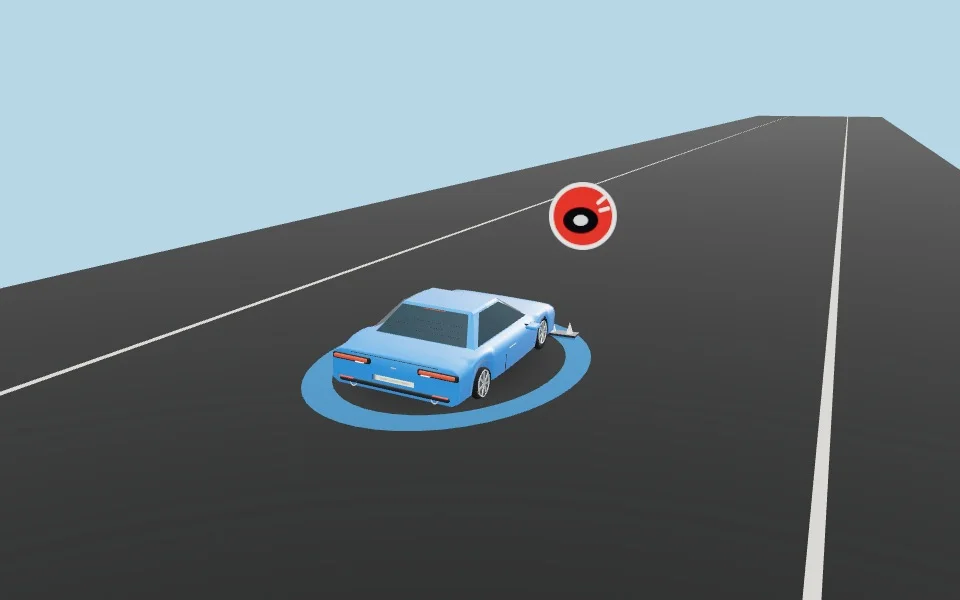
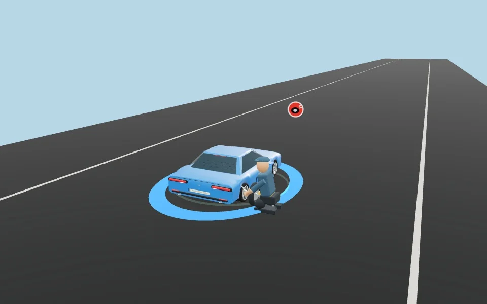
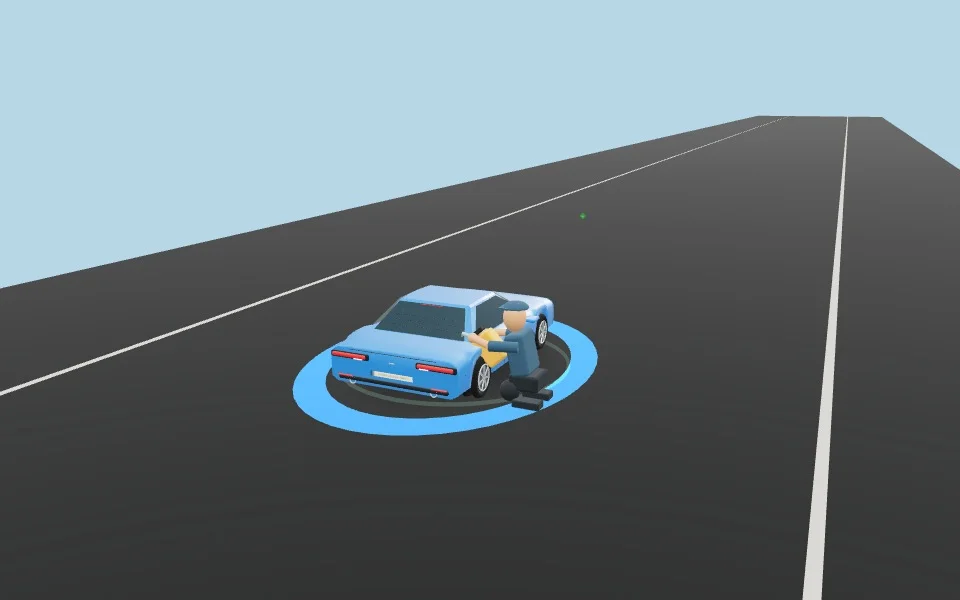
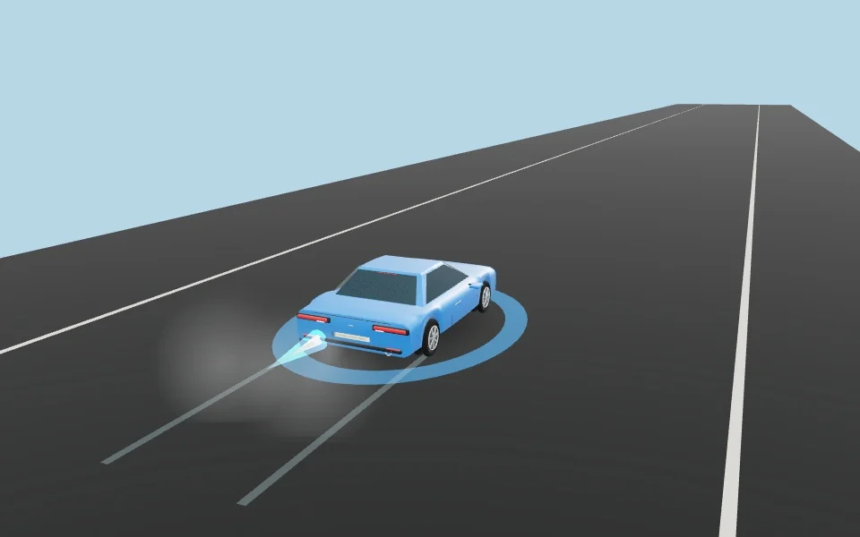

Validation : six profils de déplacement monotones avec distance exacte et départ/arrêt progressifs ; dix-neuf cas de déclenchement des cartes ; onze scénarios rendus dans Chromium sans erreur JavaScript, dont la restauration des roues et la disparition des malus après réparation. Vérifications TypeScript, ESLint et compilation de production. Dans l’interface mobile de production, l’enchaînement crevaison sur le joueur 2 → roue de secours → turbo passe sans erreur JavaScript : les deux routes sont libres et le joueur 1 atteint 100 km.

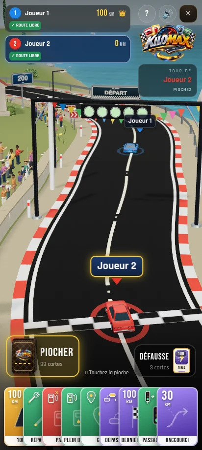

## Finition globale et avion REVANCHE GAME

Cette passe travaille l'ensemble du décor avec une palette de bord de mer, des matières plus fines et des animations discrètes. Le tracé, la largeur de route, les gabarits des voitures et la vue arrière de conduite sont conservés.

### L'avion pendant la course

L'avion publicitaire suit une boucle au large, parallèle au littoral, sans suivre la caméra. Son altitude et sa taille sont définies dans le décor. Il peut sortir du champ et revenir lors d'un autre passage, comme les avions à banderole sur les plages en été. Le texte « REVANCHE GAME » se lit des deux côtés de la toile.

L'ancien placement forcé devant la caméra et la remise à zéro de la profondeur sont retirés. L'avion respecte les masquages et la perspective du paysage.

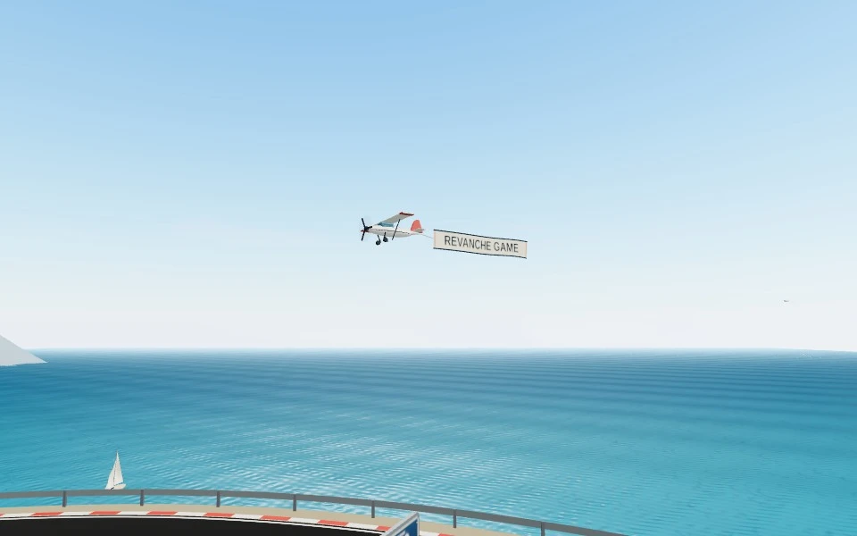

[Voir le passage au large — 8 secondes](survol-mer.mp4) · [Partie avec l'interface du jeu](kilomax-mobile.mp4)

Cette vue fixe depuis le littoral sert à inspecter le vol. La caméra de conduite reste derrière les voitures.

### Vue du jeu sur mobile

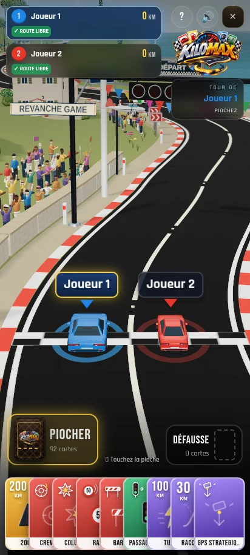

### Ce qui change dans l'ensemble du décor

- Mer : vaguelettes moins régulières, dégradé vers le large, reflets atténués, écume qui varie doucement et sillages en V attachés aux voiliers.
- Ciel et végétation : ciel atmosphérique de jour, bancs de nuages doux, feuillages qui bougent dans une brise et oliviers au second plan.
- Route : bitume noir conservé avec un relief de grain très fin, accotements minéraux, petits plots réfléchissants dans les intervalles du marquage, glissières moins brillantes et murets en pierre avec chaperons.
- Maisons : enduit et tuiles en relief discret, balcons et garde-corps, pots, stores, descentes de gouttière et lampes de porche éclairées à la tombée du jour.
- Panneaux : émail en dégradé discret et bordure intérieure, en conservant les indications et les positions.
- Voitures : feux de freinage en hauteur et lignes de dégivrage sur les lunettes arrière, sans changer les dimensions ni les interfaces d'animation.
- Personnages : les spectateurs se tournent légèrement vers les voitures proches en conservant leurs poses et leurs gestes décalés.

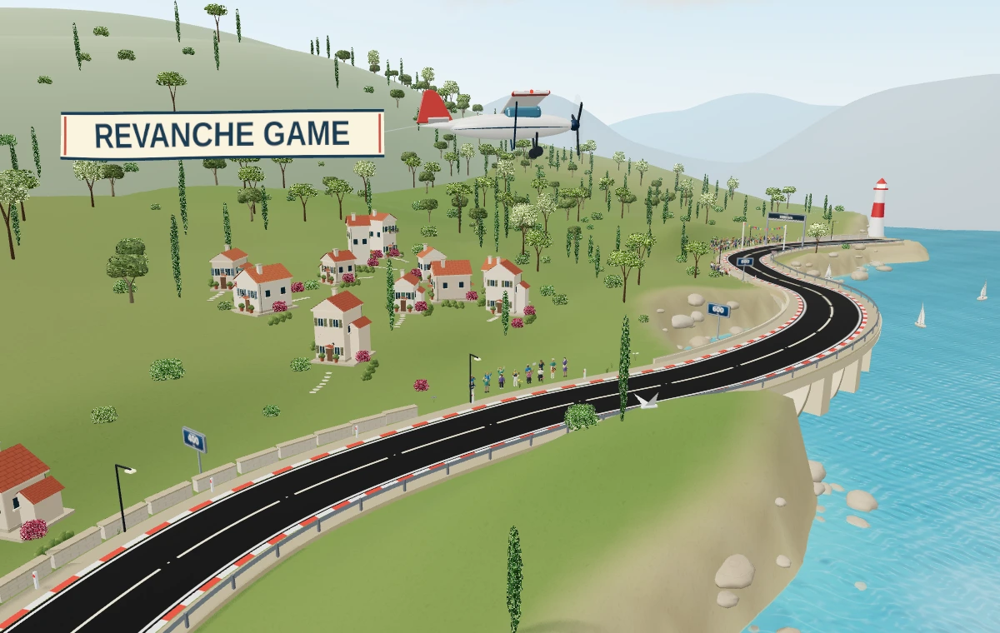

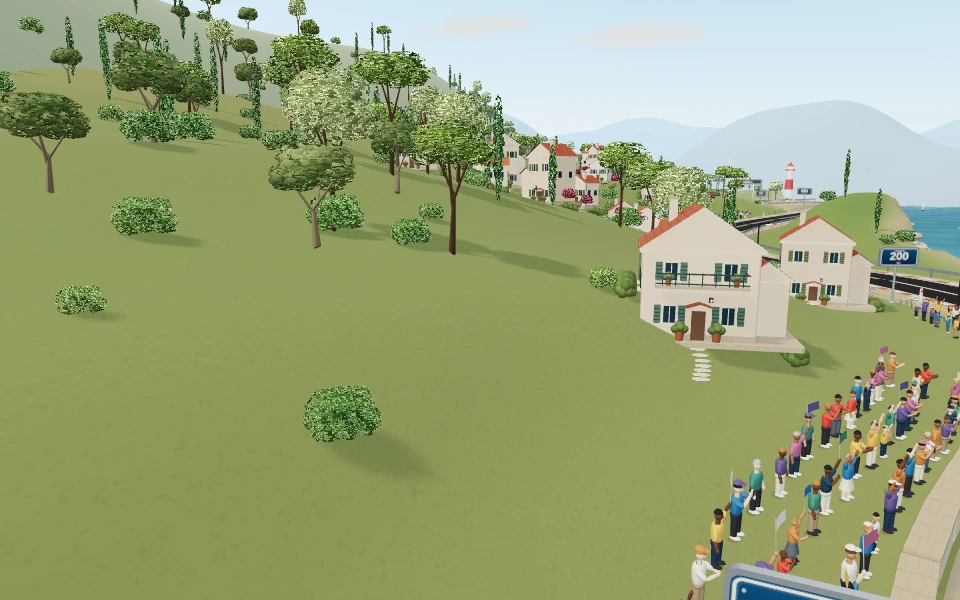

Le rendu reste stylisé. Les captures du navigateur utilisent le rendu logiciel et ne mesurent pas les performances sur téléphone.

### Vérifications de cette passe

Compilation de production, TypeScript et ESLint ciblé. Contrôles des 12 gabarits de voitures, des roues et des couleurs ; 1 272 points de sol inchangés près de la route ; espacement et ancrage des arbres ; géométries et animations de la foule ; géométries des voiliers et paramètres de l'eau. La correction du vol est contrôlée sur 1 121 positions couvrant deux boucles : l'ensemble de l'avion et de sa banderole garde plus de 11 unités de marge par rapport au rivage. Le cap suit la direction de déplacement et la boucle se referme sans saut. La caméra ne détermine plus le vol. Les contrôles de compilation et de rendu sont actualisés. Les tests de partie de la passe précédente vérifient 200 km, 100 km puis turbo, sans modification des règles par cette correction.

## Foule et personnages au bord de la route

Le parcours accueille 193 spectateurs au lieu de 32 : des groupes plus denses au départ et à l'arrivée, ainsi que plusieurs groupes sur le parcours. Leur placement reste derrière le muret, sur la terre ferme, avec un espacement minimal et en évitant maisons, troncs et portions de viaduc.

Les anciens corps en capsule sont remplacés par un torse, des jambes, des chaussures arrondies, une tête avec visage et oreilles, des cheveux et parfois une casquette. Les tailles, vêtements et carnations varient. Bras, avant-bras et mains sont articulés : applaudissements, encouragements, photos et drapeaux qui flottent, avec des rythmes décalés. Les personnages restent stylisés pour correspondre au jeu.

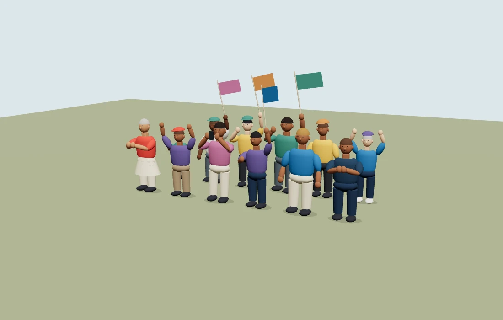

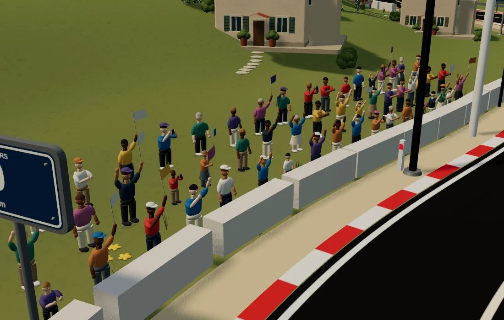

| Ancienne foule | Nouvelle foule en vue de jeu |
| --- | --- |
|  | 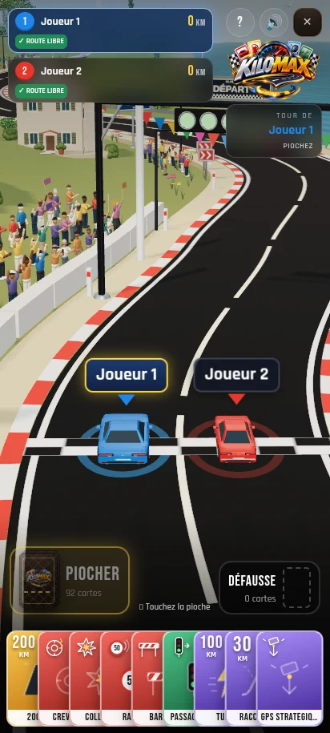 |

Les personnages partagent leurs géométries et utilisent 15 lots d'instances pour l'ensemble de la foule. La caméra de conduite, les voitures et la route ne changent pas dans cette passe. La capture vidéo utilise le rendu logiciel Chromium et ne constitue pas une mesure de performances sur téléphone.

## Voitures inspirées des modèles de série

Les carrosseries ont maintenant un capot et un coffre plus plats, des flancs avec une ligne d'épaule et des passages de roues moins bombés. L'habitacle est peint, avec des montants visibles, une lunette arrière, un pare-brise et des vitres latérales distinctes. Les blocs de feux, les pare-chocs, les plaques et les rétroviseurs sont plus discrets. Les matériaux présentent des reflets atténués. Ces modèles restent stylisés pour le jeu mobile ; ce ne sont pas des reproductions de marques automobiles.

| Version précédente | Nouvelle carrosserie |
| --- | --- |
|  | 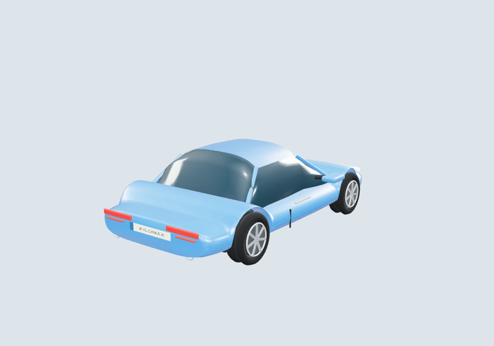 |

Rendus des modèles réellement utilisés dans le jeu :

| SUV | Van | Rétro |
| --- | --- | --- |
| 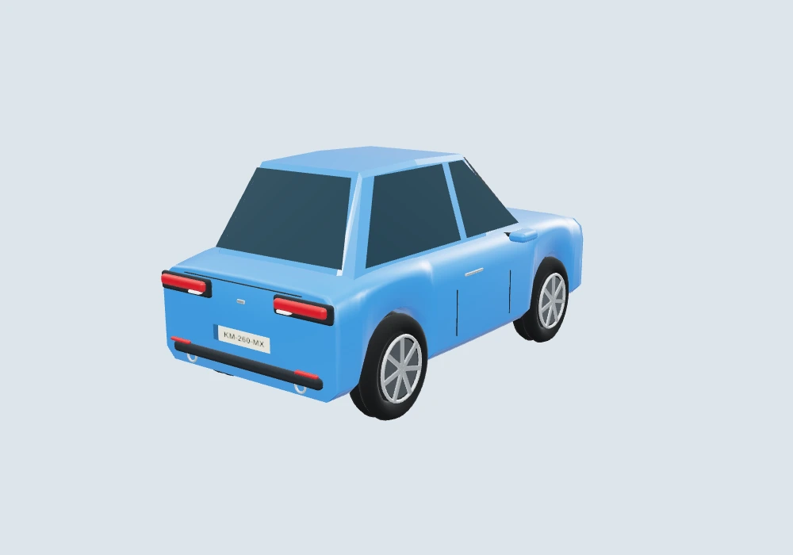 | 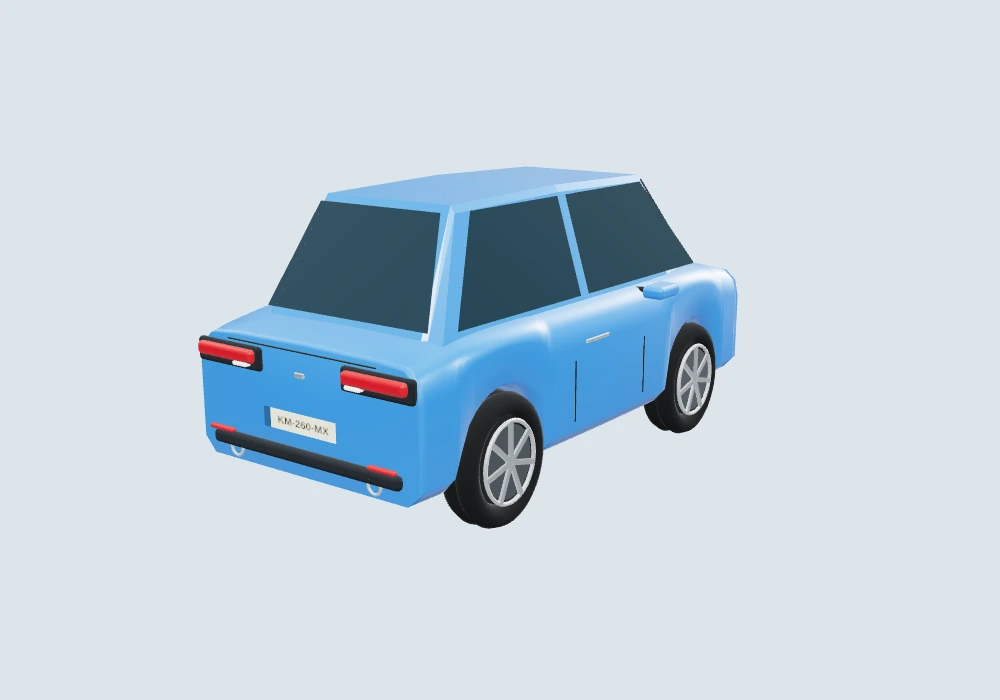 | 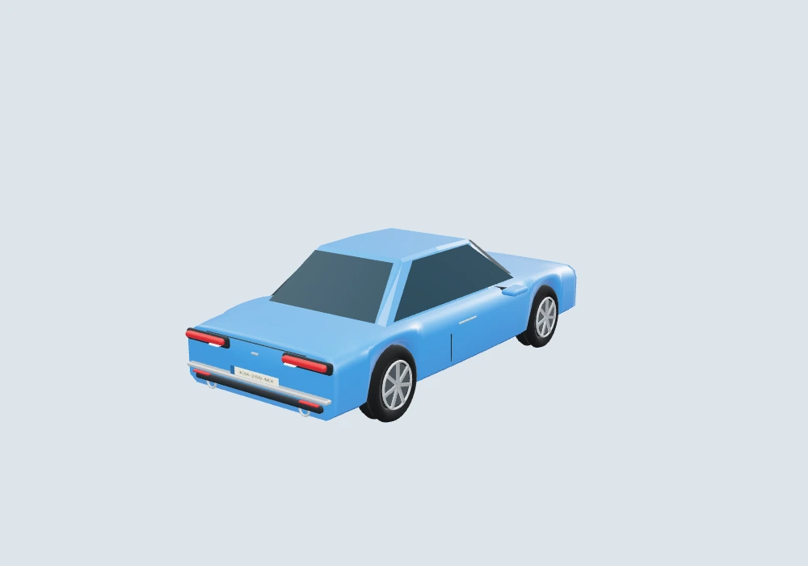 |

Les 12 gabarits extérieurs restent identiques aux modèles précédents. Les quatre roues, les feux de freinage et les fixations des équipements conservent leur interface d'animation. Les miniatures du garage correspondent aux nouvelles formes. La caméra de course, la route et la logique de conduite n'ont pas changé. Les véhicules spéciaux (motos, kart, formule, proto et tracteur) conservent leur modèle.

## Bitume plus noir

Un enrobé noir mat, inspiré d'une autoroute récemment revêtue : grain très fin, traces de pneus discrètes, reflets gris atténués. Les anciens rectangles de réparation et les fissures ont été retirés. Le tracé, la largeur, les bordures et la disposition des marquages sont conservés.

| Ancienne texture | Nouveau bitume |
| --- | --- |
| 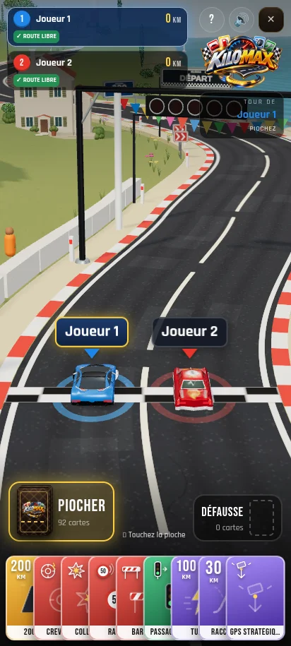 | 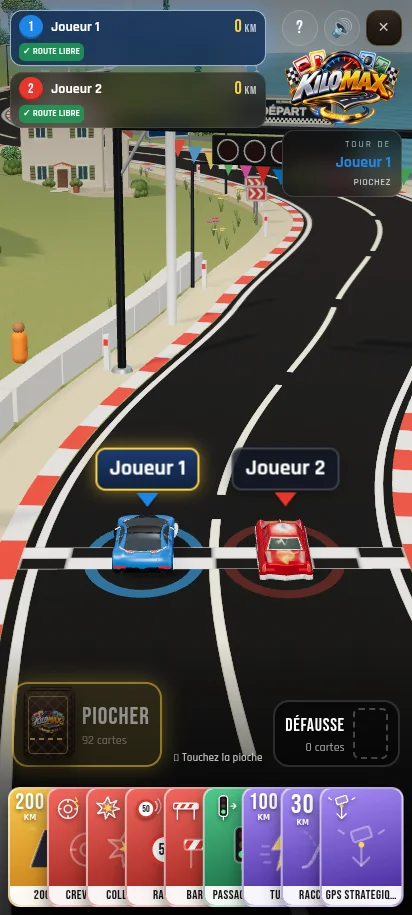 |

## Reliefs et composition du paysage

Les anciennes masses isolées sont remplacées par des crêtes continues, avec des vallées et des collines plus basses. Les falaises présentent des variations plus douces et des nuances de calcaire. Les arbres sont regroupés en bosquets, avec des clairières, des tailles variées et de l'espace autour des maisons. Les troncs restent ancrés sur le relief visible.

Même cadrage du littoral pour comparer les deux versions :

| Avant cette passe | Nouveau paysage |
| --- | --- |
|  |  |

De petits chemins de pierres et des haies relient les maisons au terrain. La lumière du jour est moins contrastée et les ombres sont plus douces.

Le sol à proximité de la route conserve son profil d'origine. La route et la caméra arrière sont conservées.

## Panneaux et portiques

Plaques arrondies avec bord métallique, face imprimée distincte, vis, fixations arrière et socle. Les repères de distance portent un nombre dominant et l'unité « km ». Les chevrons conservent leur sens et leur position dans les virages.

| Panneau de distance | Chevrons de virage |
| --- | --- |
|  |  |

Les feux de départ ont des bagues et des protections. Le nouveau panneau DÉPART et le bandeau ARRIVÉE partagent un motif à damier. Les cinq feux et leur compte à rebours sont conservés.

| Départ | Arrivée |
| --- | --- |
|  |  |

## Arbres et végétation

Pins aux troncs ramifiés, oliviers plus hauts et plus clairs, cyprès à plusieurs étages de feuillage. Les feuilles dessinent des contours irréguliers. Les buissons, les herbes et les fleurs ont aussi été retravaillés : les petites boules du bas-côté sont remplacées par des brins et des pétales.

## Bateaux

Coques courbes avec pont, cabine arrondie, fenêtres, mât et haubans. Les deux voiles sont des surfaces bombées. Les bateaux gardent leur déplacement et leur balancement.

## Mer, rochers et littoral

La surface de l'eau a une légère houle animée et des reflets plus doux. Les rochers sont arrondis et irréguliers, les reliefs sont plus larges, et le littoral est dessiné avec davantage de points. L'eau claire près de la côte se fond progressivement dans la mer.

Ces captures rapprochent le décor pour montrer les détails. Ces cadrages d'inspection ne remplacent pas la caméra de jeu.

## Autres éléments du décor

Les volumes principaux des maisons, les poteaux, les panneaux et les lampes ont des arêtes adoucies. Le phare et les rochers utilisent des courbes plus fines. Les petites moulures et fenêtres restent simples pour conserver un modèle léger.

## Maisons

Toits à deux pentes et pignons en crépi, cheminée, annexe plus basse, volets à lames, appuis de fenêtres en relief, auvent et pots à l'entrée.

## Vue de jeu

[Voir l'enregistrement du jeu](kilomax-mobile.mp4).

La caméra de jeu reste derrière les véhicules. Le tracé, la largeur et les dimensions de la route, les voitures et leurs animations sont conservés.

Vidéo enregistrée dans Chromium avec rendu logiciel. Sa fluidité ne mesure pas les performances sur téléphone.
