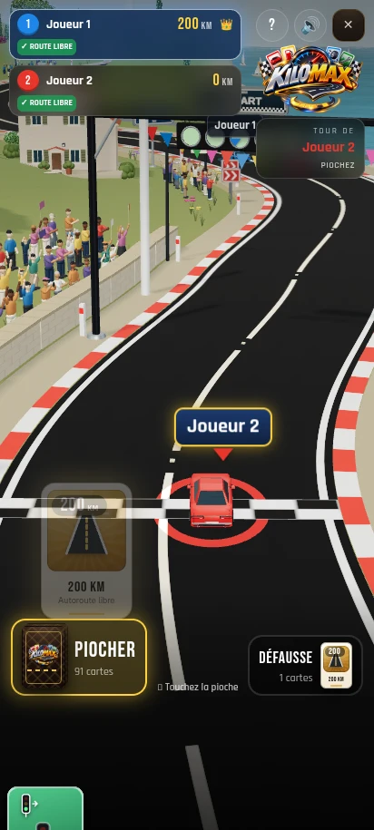
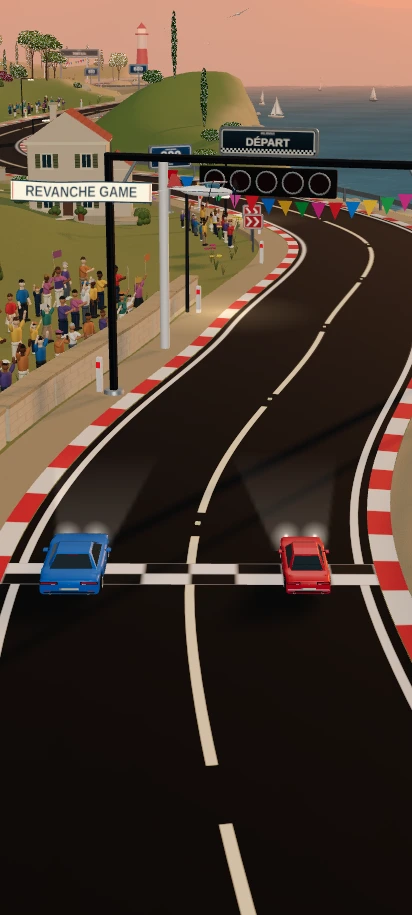
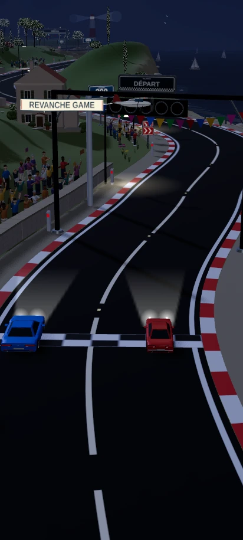

# Kilomax — décor, voitures et finition de la course

## Finition globale et avion REVANCHE GAME

Cette passe travaille l'ensemble du décor avec une palette de bord de mer, des matières plus fines et des animations discrètes. Le tracé, la largeur de route, les gabarits des voitures et la vue arrière de conduite sont conservés.

### L'avion pendant la course

Un avion à hélice accompagne la course avec une banderole « REVANCHE GAME ». Hélice, léger roulis et tissu sont animés. Son trajet d'accompagnement reste dans la partie gauche du cadre pour garder le texte visible pendant les changements de joueur et de champ de vision. Le modèle est éclairé et ses pièces se masquent correctement entre elles ; la banderole reste lisible sur les ambiances jour, crépuscule et nuit.

### Vue du jeu sur mobile

| Avant cette passe | Finition globale |
| --- | --- |
|  |  |

[Visite du circuit — 20 secondes, sans interface](kilomax-visite.mp4) · [Partie enregistrée — 30 secondes, avec interface](kilomax-mobile.mp4)

La visite est rendue image par image à 24 images par seconde avec les modèles, les matières, les animations du décor et la caméra arrière du moteur. Elle parcourt le circuit jusqu'à l'arrivée et montre aussi le champ de vision du turbo. C'est un aperçu visuel du décor, distinct de l'enregistrement de la partie et d'une mesure de performances sur téléphone.

### Ce qui change dans l'ensemble du décor

- Mer : vaguelettes moins régulières, dégradé vers le large, reflets atténués, écume qui varie doucement et sillages en V attachés aux voiliers.
- Ciel et végétation : ciel atmosphérique de jour, bancs de nuages doux, feuillages qui bougent dans une brise et oliviers au second plan.
- Route : bitume noir conservé avec un relief de grain très fin, accotements minéraux, petits plots réfléchissants dans les intervalles du marquage, glissières moins brillantes et murets en pierre avec chaperons.
- Maisons : enduit et tuiles en relief discret, balcons et garde-corps, pots, stores, descentes de gouttière et lampes de porche éclairées à la tombée du jour.
- Panneaux : émail en dégradé discret et bordure intérieure, en conservant les indications et les positions.
- Voitures : feux de freinage en hauteur et lignes de dégivrage sur les lunettes arrière, sans changer les dimensions ni les interfaces d'animation.
- Personnages : les spectateurs se tournent légèrement vers les voitures proches en conservant leurs poses et leurs gestes décalés.

| Crépuscule | Nuit |
| --- | --- |
|  |  |

Les vues rapprochées et d'ensemble inspectent le moteur du jeu sans son interface ; elles ne remplacent pas la caméra de conduite. Le rendu reste stylisé. Les captures Chromium utilisent le rendu logiciel et ne mesurent pas la fluidité sur téléphone.

### Vérifications de cette passe

Compilation de production, TypeScript et ESLint ciblé. Contrôles des 12 gabarits de voitures, des roues et des couleurs ; 1 272 points de sol inchangés près de la route ; espacement et ancrage des arbres ; géométries et animations de la foule ; géométries des voiliers et paramètres de l'eau. La banderole a été vérifiée sur 72 combinaisons de taille d'écran, de champ de vision, d'orientation et de temps. Les trois ambiances sont rendues sans erreur JavaScript ou de shader dans le navigateur. La partie de production vérifie 200 km, 100 km puis turbo, avec des distances finales de 300 km et 100 km et sans erreur JavaScript.

## Foule et personnages au bord de la route

Le parcours accueille 193 spectateurs au lieu de 32 : des groupes plus denses au départ et à l'arrivée, ainsi que plusieurs groupes sur le parcours. Leur placement reste derrière le muret, sur la terre ferme, avec un espacement minimal et en évitant maisons, troncs et portions de viaduc.

Les anciens corps en capsule sont remplacés par un torse, des jambes, des chaussures arrondies, une tête avec visage et oreilles, des cheveux et parfois une casquette. Les tailles, vêtements et carnations varient. Bras, avant-bras et mains sont articulés : applaudissements, encouragements, photos et drapeaux qui flottent, avec des rythmes décalés. Les personnages restent stylisés pour correspondre au jeu.

| Ancienne foule | Nouvelle foule en vue de jeu |
| --- | --- |
|  |  |

Les personnages partagent leurs géométries et utilisent 15 lots d'instances pour l'ensemble de la foule. La caméra de conduite, les voitures et la route ne changent pas dans cette passe. La capture vidéo utilise le rendu logiciel Chromium et ne constitue pas une mesure de performances sur téléphone.

## Voitures inspirées des modèles de série

Les carrosseries ont maintenant un capot et un coffre plus plats, des flancs avec une ligne d'épaule et des passages de roues moins bombés. L'habitacle est peint, avec des montants visibles, une lunette arrière, un pare-brise et des vitres latérales distinctes. Les blocs de feux, les pare-chocs, les plaques et les rétroviseurs sont plus discrets. Les matériaux présentent des reflets atténués. Ces modèles restent stylisés pour le jeu mobile ; ce ne sont pas des reproductions de marques automobiles.

| Version précédente | Nouvelle carrosserie |
| --- | --- |
|  |  |

Rendus des modèles réellement utilisés dans le jeu :

| SUV | Van | Rétro |
| --- | --- | --- |
|  |  |  |

Les 12 gabarits extérieurs restent identiques aux modèles précédents. Les quatre roues, les feux de freinage et les fixations des équipements conservent leur interface d'animation. Les miniatures du garage correspondent aux nouvelles formes. La caméra de course, la route et la logique de conduite n'ont pas changé. Les véhicules spéciaux (motos, kart, formule, proto et tracteur) conservent leur modèle.

## Bitume plus noir

Un enrobé noir mat, inspiré d'une autoroute récemment revêtue : grain très fin, traces de pneus discrètes, reflets gris atténués. Les anciens rectangles de réparation et les fissures ont été retirés. Le tracé, la largeur, les bordures et la disposition des marquages sont conservés.

| Ancienne texture | Nouveau bitume |
| --- | --- |
|  |  |

## Reliefs et composition du paysage

Les anciennes masses isolées sont remplacées par des crêtes continues, avec des vallées et des collines plus basses. Les falaises présentent des variations plus douces et des nuances de calcaire. Les arbres sont regroupés en bosquets, avec des clairières, des tailles variées et de l'espace autour des maisons. Les troncs restent ancrés sur le relief visible.

Même cadrage du littoral pour comparer les deux versions :

| Avant cette passe | Nouveau paysage |
| --- | --- |
|  |  |

De petits chemins de pierres et des haies relient les maisons au terrain. La lumière du jour est moins contrastée et les ombres sont plus douces.

Le sol à proximité de la route conserve son profil d'origine. La route et la caméra arrière sont conservées.

## Panneaux et portiques

Plaques arrondies avec bord métallique, face imprimée distincte, vis, fixations arrière et socle. Les repères de distance portent un nombre dominant et l'unité « km ». Les chevrons conservent leur sens et leur position dans les virages.

| Panneau de distance | Chevrons de virage |
| --- | --- |
|  |  |

Les feux de départ ont des bagues et des protections. Le nouveau panneau DÉPART et le bandeau ARRIVÉE partagent un motif à damier. Les cinq feux et leur compte à rebours sont conservés.

| Départ | Arrivée |
| --- | --- |
|  |  |

## Arbres et végétation

Pins aux troncs ramifiés, oliviers plus hauts et plus clairs, cyprès à plusieurs étages de feuillage. Les feuilles dessinent des contours irréguliers. Les buissons, les herbes et les fleurs ont aussi été retravaillés : les petites boules du bas-côté sont remplacées par des brins et des pétales.

## Bateaux

Coques courbes avec pont, cabine arrondie, fenêtres, mât et haubans. Les deux voiles sont des surfaces bombées. Les bateaux gardent leur déplacement et leur balancement.

## Mer, rochers et littoral

La surface de l'eau a une légère houle animée et des reflets plus doux. Les rochers sont arrondis et irréguliers, les reliefs sont plus larges, et le littoral est dessiné avec davantage de points. L'eau claire près de la côte se fond progressivement dans la mer.

Ces captures rapprochent le décor pour montrer les détails. Ces cadrages d'inspection ne remplacent pas la caméra de jeu.

## Autres éléments du décor

Les volumes principaux des maisons, les poteaux, les panneaux et les lampes ont des arêtes adoucies. Le phare et les rochers utilisent des courbes plus fines. Les petites moulures et fenêtres restent simples pour conserver un modèle léger.

## Maisons

Toits à deux pentes et pignons en crépi, cheminée, annexe plus basse, volets à lames, appuis de fenêtres en relief, auvent et pots à l'entrée.

## Vue de jeu

[Voir l'enregistrement du jeu](kilomax-mobile.mp4).

La caméra de jeu reste derrière les véhicules. Le tracé, la largeur et les dimensions de la route, les voitures et leurs animations sont conservés.

Vidéo enregistrée dans Chromium avec rendu logiciel. Sa fluidité ne mesure pas les performances sur téléphone.
