# Décor de Kilomax — aperçu de travail

## Reliefs et composition du paysage

Les anciennes masses isolées sont remplacées par des crêtes continues, avec des vallées et des collines plus basses. Les falaises présentent des variations plus douces et des nuances de calcaire. Les arbres sont regroupés en bosquets, avec des clairières, des tailles variées et de l'espace autour des maisons. Les troncs restent ancrés sur le relief visible.

Même cadrage du littoral pour comparer les deux versions :

| Avant cette passe | Nouveau paysage |
| --- | --- |
| 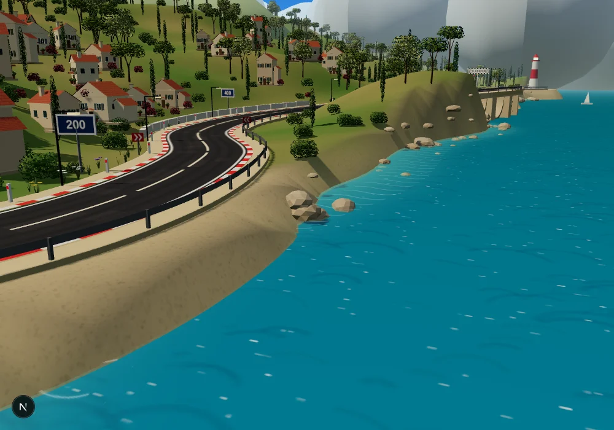 | 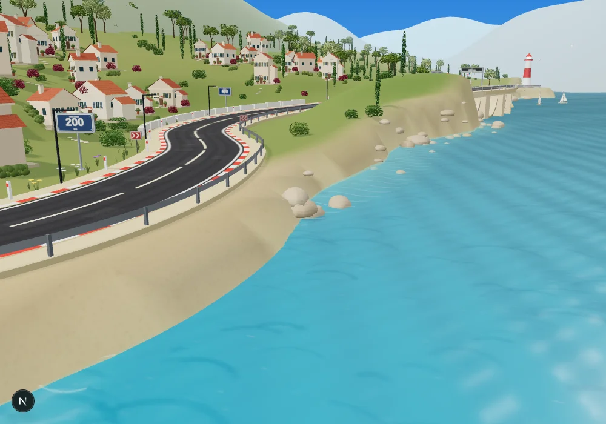 |

De petits chemins de pierres et des haies relient les maisons au terrain. La lumière du jour est moins contrastée et les ombres sont plus douces.

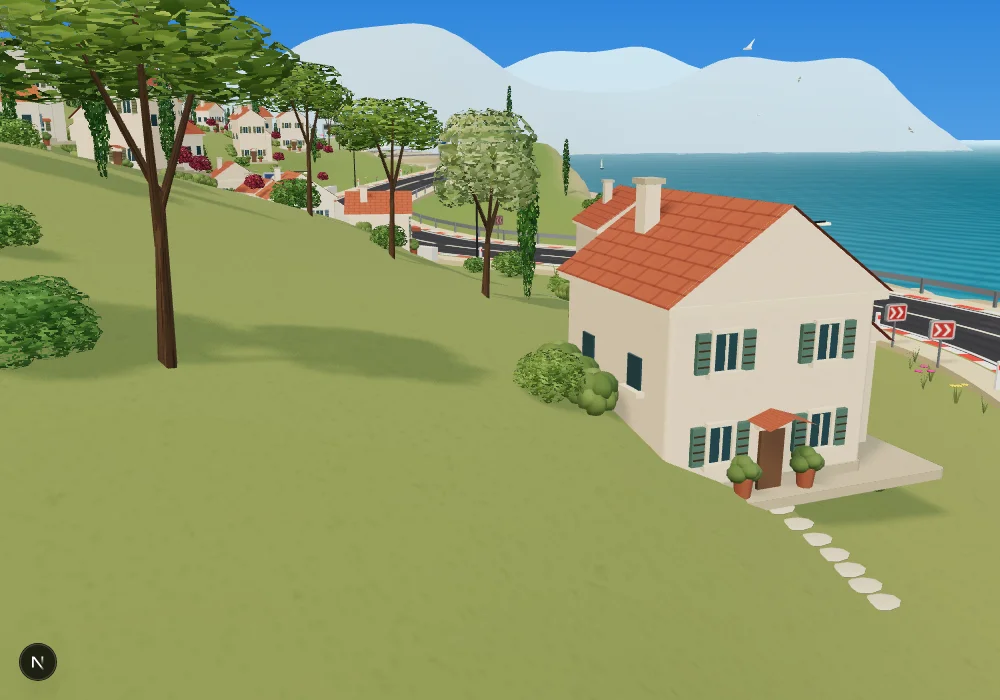

Le sol à proximité de la route conserve son profil d'origine. La route, les voitures et la caméra arrière sont conservées.

## Panneaux et portiques

Plaques arrondies avec bord métallique, face imprimée distincte, vis, fixations arrière et socle. Les repères de distance portent un nombre dominant et l'unité « km ». Les chevrons conservent leur sens et leur position dans les virages.

| Panneau de distance | Chevrons de virage |
| --- | --- |
| 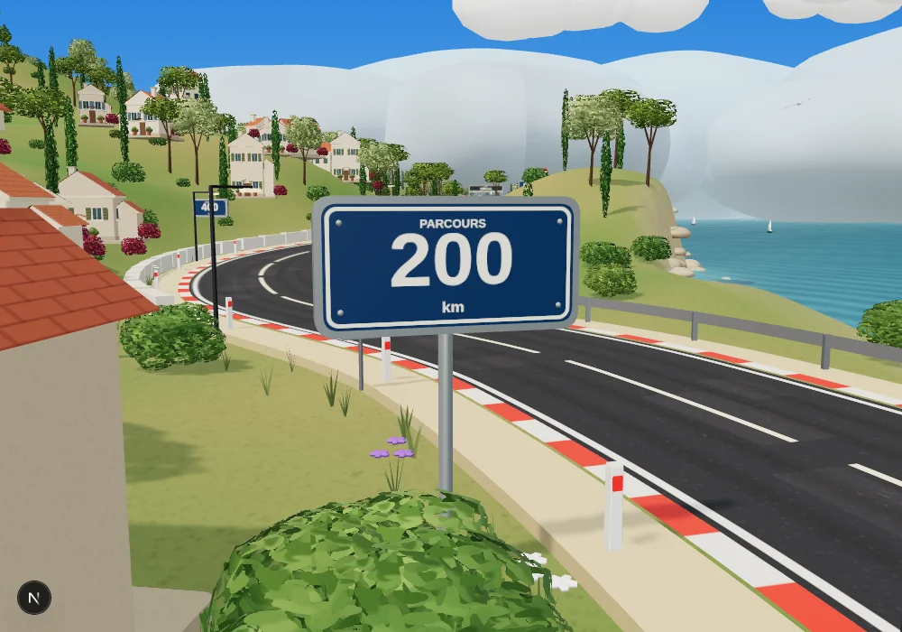 | 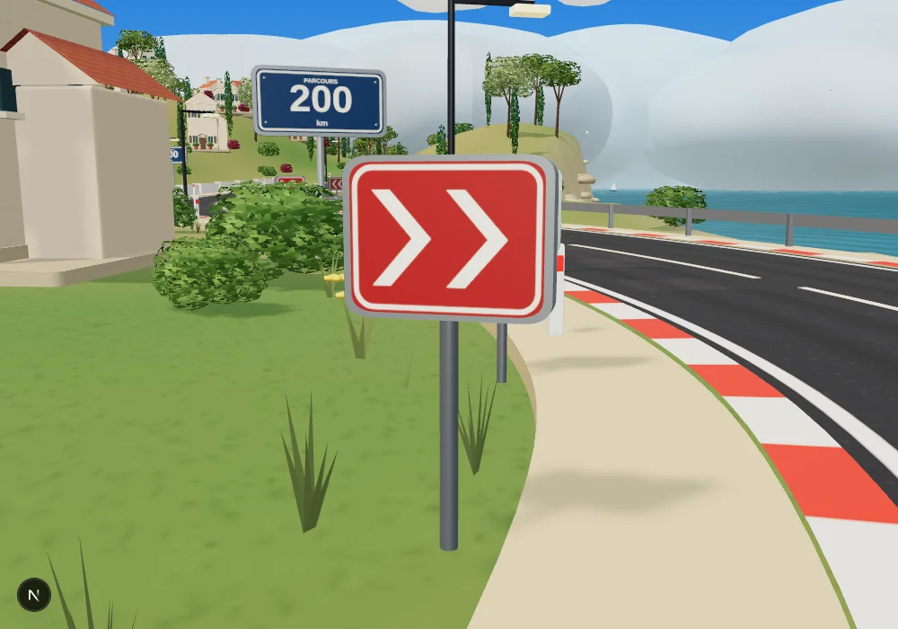 |

Les feux de départ ont des bagues et des protections. Le nouveau panneau DÉPART et le bandeau ARRIVÉE partagent un motif à damier. Les cinq feux et leur compte à rebours sont conservés.

| Départ | Arrivée |
| --- | --- |
| 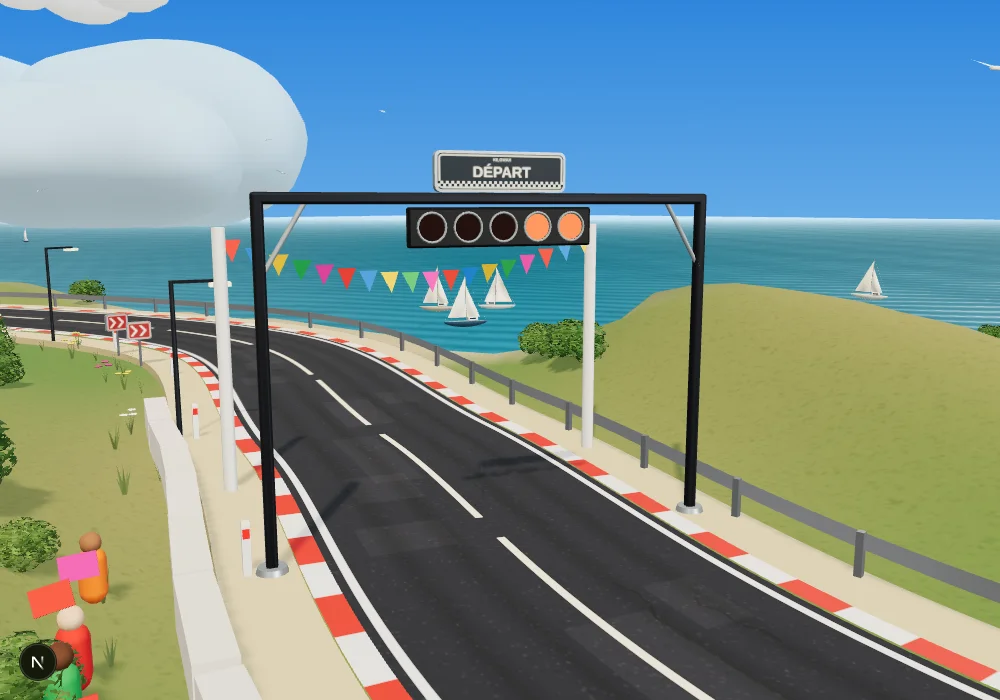 | 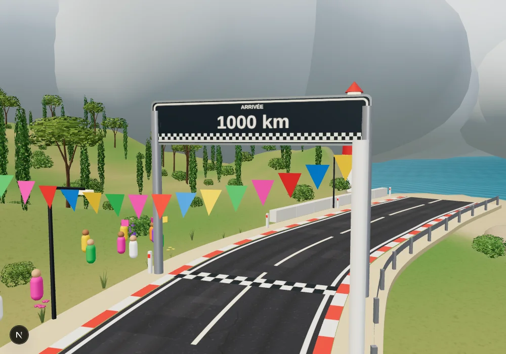 |

## Arbres et végétation

Pins aux troncs ramifiés, oliviers plus hauts et plus clairs, cyprès à plusieurs étages de feuillage. Les feuilles dessinent des contours irréguliers. Les buissons, les herbes et les fleurs ont aussi été retravaillés : les petites boules du bas-côté sont remplacées par des brins et des pétales.

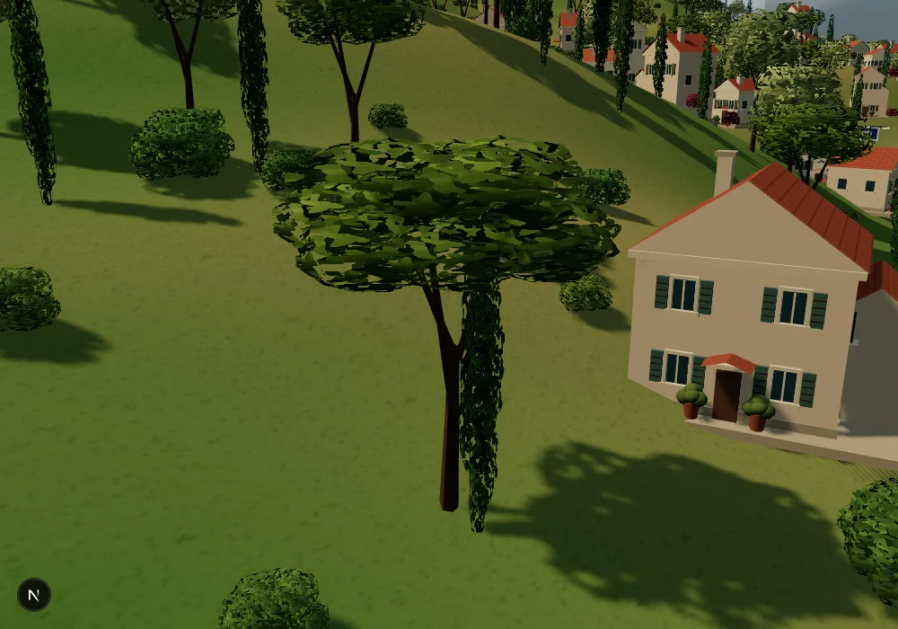

## Bateaux

Coques courbes avec pont, cabine arrondie, fenêtres, mât et haubans. Les deux voiles sont des surfaces bombées. Les bateaux gardent leur déplacement et leur balancement.

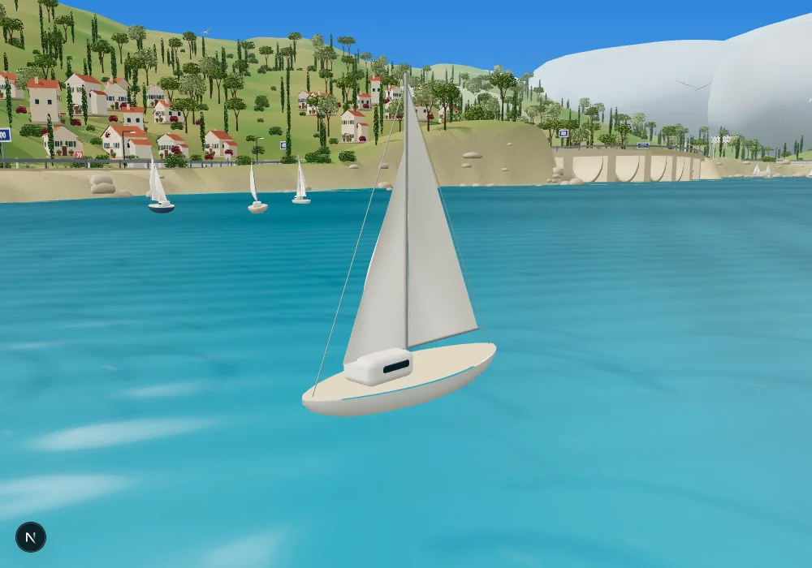

## Mer, rochers et littoral

La surface de l'eau a une légère houle animée et des reflets plus doux. Les rochers sont arrondis et irréguliers, les reliefs sont plus larges, et le littoral est dessiné avec davantage de points. L'eau claire près de la côte se fond progressivement dans la mer.

Ces captures rapprochent le décor pour montrer les détails. Ces cadrages d'inspection ne remplacent pas la caméra de jeu.

## Autres éléments du décor

Les volumes principaux des maisons, les poteaux, les panneaux et les lampes ont des arêtes adoucies. Le phare et les rochers utilisent des courbes plus fines. Les petites moulures et fenêtres restent simples pour conserver un modèle léger.

## Maisons

Toits à deux pentes et pignons en crépi, cheminée, annexe plus basse, volets à lames, appuis de fenêtres en relief, auvent et pots à l'entrée.

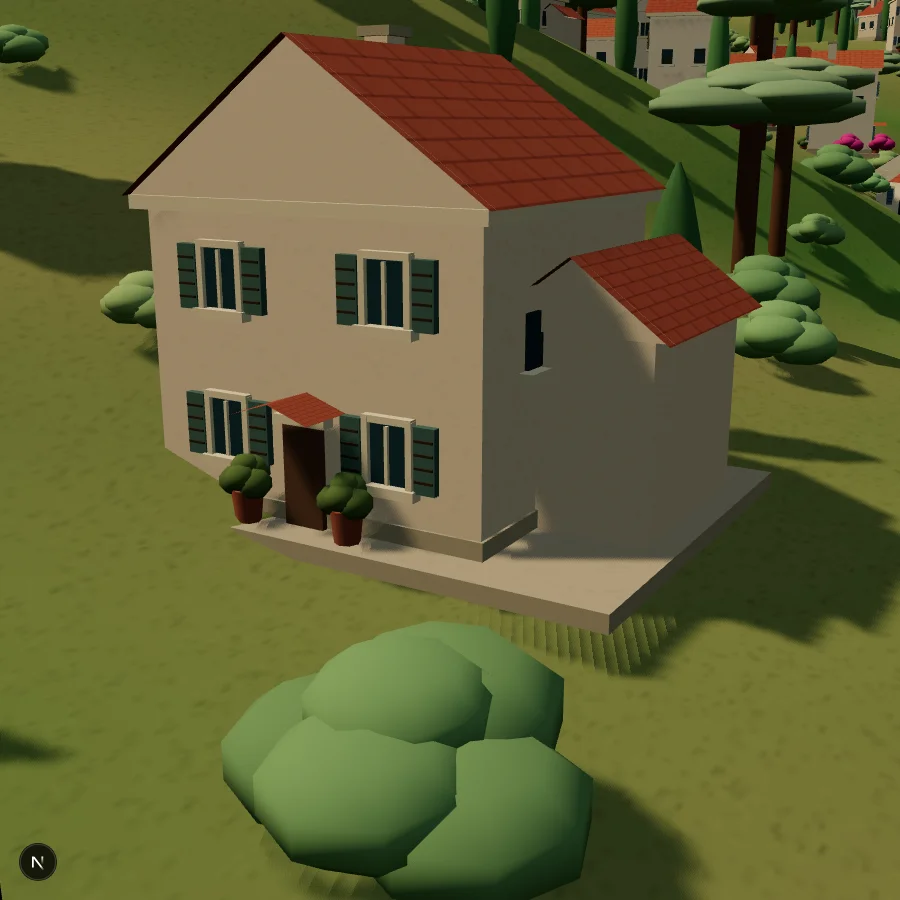

## Vue de jeu

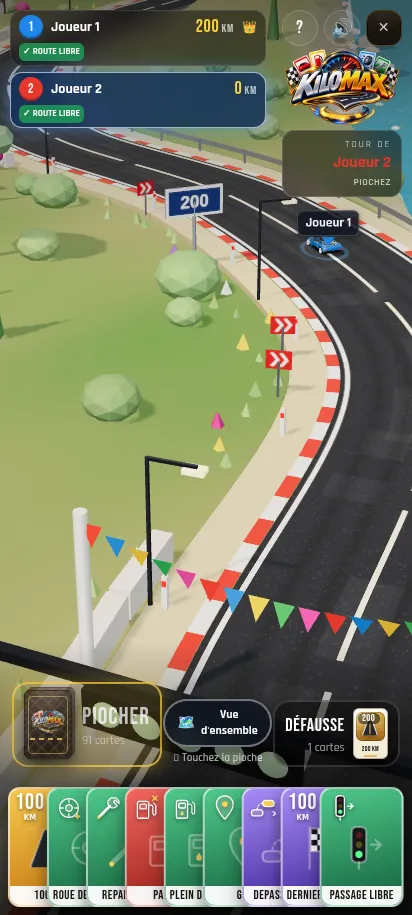

[Voir l'enregistrement du jeu](kilomax-mobile.mp4).

La caméra de jeu reste derrière les véhicules. Le tracé, la largeur et les dimensions de la route, les voitures et leurs animations sont conservés.

Vidéo enregistrée dans Chromium avec rendu logiciel. Sa fluidité ne mesure pas les performances sur téléphone.
