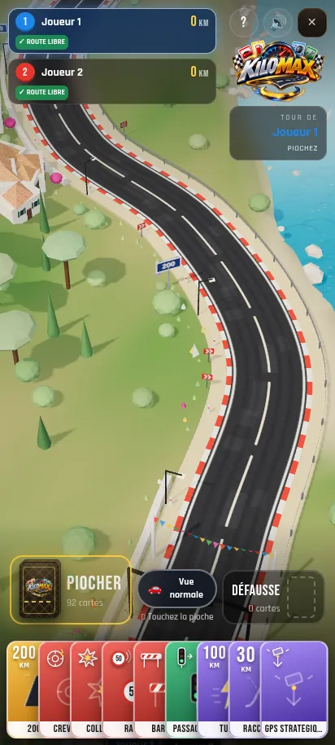

# Aperçu de la première retouche graphique

Captures du jeu existant au format mobile 412 × 915. Cette première passe garde les modèles et le style actuels : crépi, tuiles, volets et fenêtres des maisons, nuances du paysage et finition satinée des véhicules.

Le tracé, la largeur de la route, les vues, l'échelle des véhicules et les animations restent ceux du jeu actuel.

| Vue course | Vue d'ensemble |
| --- | --- |
|  |  |

[Voir la vidéo de 20 secondes](kilomax-mobile.mp4).

La vidéo est un enregistrement de la version de travail du jeu, réalisé dans Chromium avec rendu logiciel. Sa fluidité ne mesure pas les performances sur téléphone.
