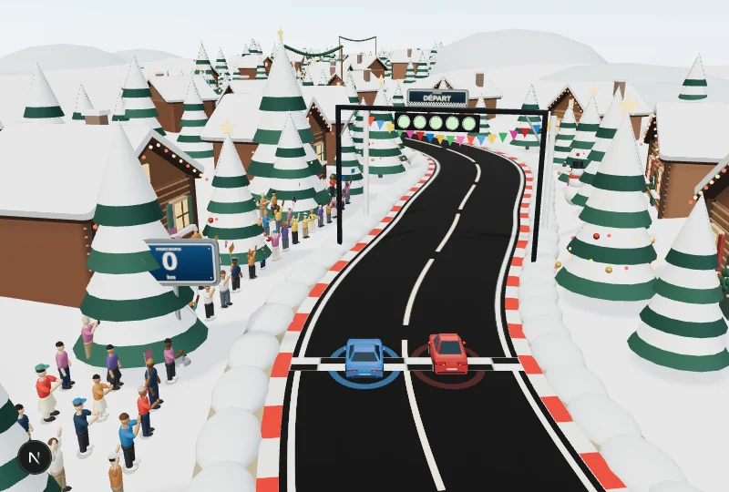
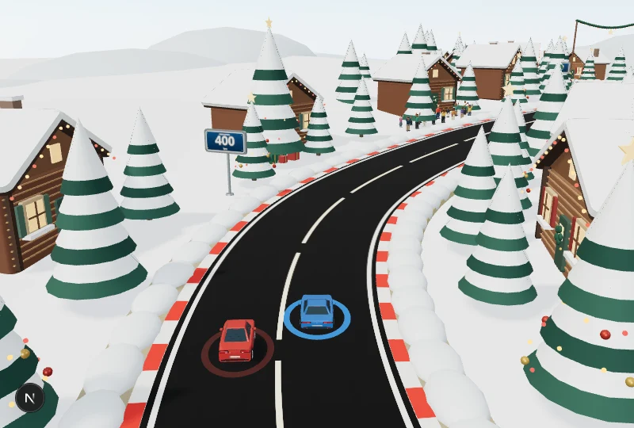
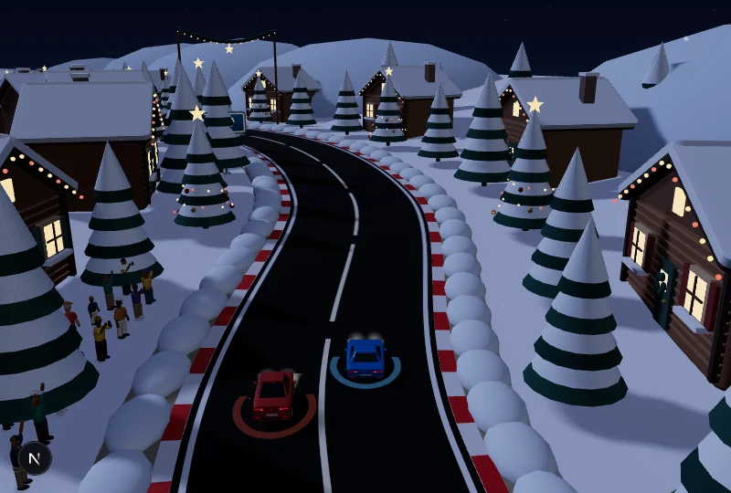

# Village de Noël — neige animée dans Kilomax

Le troisième circuit se choisit dans **Créer une partie → Plateau 3D → Circuit → Village de Noël**. La côte et la ville restent disponibles. Comme les autres décors, le choix est mémorisé sur l’appareil.

[Voir la neige tomber dans le moteur — 3 secondes](neige-noel.mp4)

Cette capture utilise les voitures et la vue arrière du jeu. Les images sont calculées à pas fixe pour montrer la chute des flocons ; ce film ne mesure pas les performances sur téléphone.

## Le village

34 chalets en bois avec toits pentus et neige sur les pans, les rebords de fenêtre et les cheminées. Les fenêtres sont éclairées, les volets alternent entre vert et rouge et les façades portent des guirlandes. Les sapins enneigés comprennent de grands arbres de Noël, des boules, des lumières et des étoiles. Des cadeaux, bonshommes de neige et guirlandes suspendues complètent le parcours.

## Une neige qui tombe

1 000 flocons descendent doucement dans l’espace 3D, avec un léger déplacement latéral. Le volume de neige se renouvelle autour de la caméra ; les flocons restent placés dans le monde et respectent la profondeur du décor. Ils ne sont pas une image superposée à l’écran. Leur position dépend du temps, sans cumul dépendant du nombre d’images par seconde.

La chaussée reste dégagée : même tracé, largeur, taille de voiture, vue arrière, règles et animations, y compris le dépassement. Les congères, arbres et chalets se placent en dehors de la piste. Les trois ambiances d’éclairage restent disponibles. L’avion continue de survoler la mer sur la map côtière.

Les éléments du décor utilisent des géométries partagées et des instances. Les flocons utilisent un seul objet de particules et un tampon réutilisé ; les fenêtres et guirlandes éclairées n’ajoutent pas une source lumineuse par ampoule.

Validation : 45 comparaisons des positions avec la côte (trois distances, cinq positions, trois files), matrices finies, chute et déterminisme des flocons vérifiés dans Chromium. Captures de jour, au crépuscule et de nuit sans erreur JavaScript ; vérifications ESLint, TypeScript et compilation de production.
