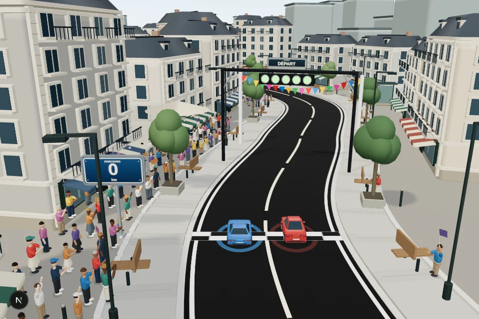
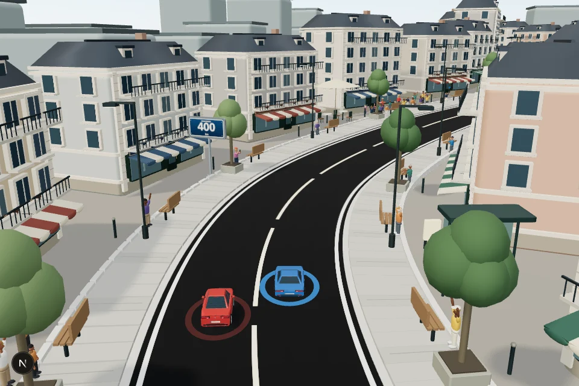
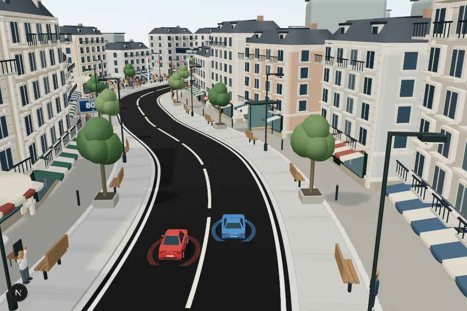
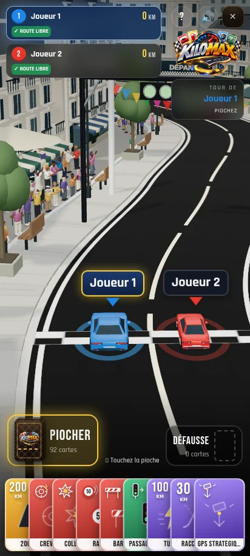
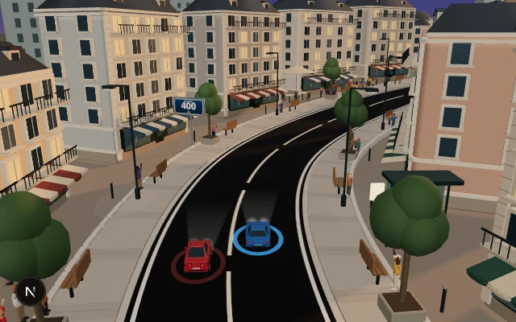
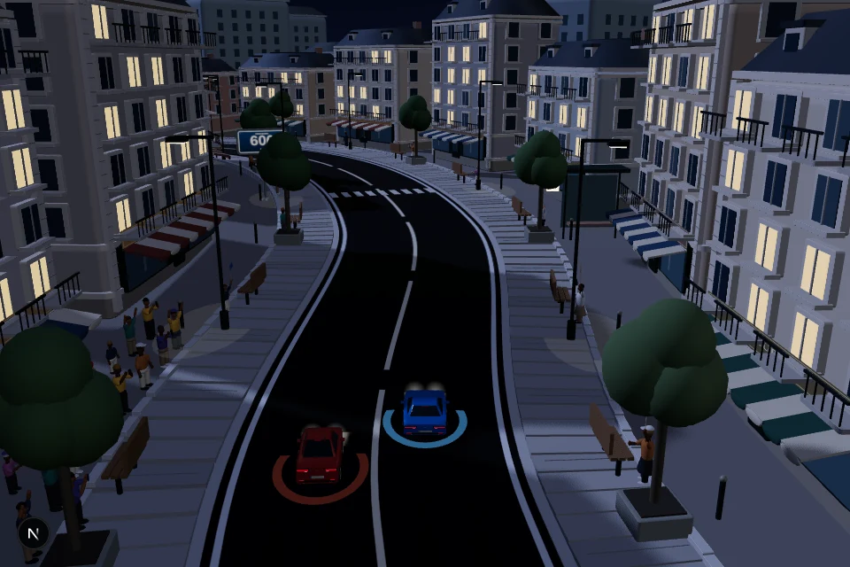

# Grand Boulevard — deuxième circuit de Kilomax

Le circuit se choisit dans **Créer une partie → Circuit**, lorsque le plateau 3D est sélectionné. **Corniche d’Azur** reste disponible ; **Grand Boulevard** remplace son décor par une ville. Le choix est mémorisé sur l’appareil, comme celui du plateau 2D/3D. En ligne, chaque pilote peut choisir le décor affiché sur son propre appareil.

## Une course en ville

42 immeubles bordent la route : façades avec encadrements de fenêtres, corniches, balcons en ferronnerie, mansardes, lucarnes et cheminées. Les rez-de-chaussée accueillent des vitrines, des enseignes et des stores rayés. Les angles et les côtés des bâtiments sont détaillés pour les vues en virage.

Les trottoirs suivent le relief et les courbes. Ils accueillent des arbres en jardinière, des bancs, des bornes, des lampadaires, des terrasses et des abribus. Les passages piétons sont peints sur la chaussée. Les spectateurs gardent leurs animations.

## Vue de jeu sur mobile

## Jour, crépuscule et nuit

Les ambiances existantes restent disponibles. Les fenêtres s’éclairent dans certains appartements et les lampadaires déposent des halos sur les trottoirs. Les phares et les effets des voitures restent ceux du jeu.

## Même dynamique

Le tracé, les virages, la largeur de route, la taille des voitures, la vue arrière, les cartes et les distances sont conservés, y compris le dépassement corrigé. L’avion au-dessus de la mer reste sur la map côtière.

La ville est construite avec des éléments instanciés et des géométries partagées. Les bâtiments sont placés en contrôlant leurs angles par rapport à la route. Les fenêtres éclairées et les halos utilisent des matériaux, sans multiplier les sources lumineuses.

Validation : compilation de production, TypeScript et ESLint ; 45 comparaisons de positions entre les deux maps (700, 1 000 et 1 500 km, cinq positions, trois files) ; matrices du décor finies ; captures Chromium à quatre endroits, de jour, au crépuscule et de nuit, sans erreur JavaScript. Dans l’interface mobile de production, le joueur 1 parcourt 200 km, puis le joueur 2 le dépasse et atteint 210 km, sans erreur JavaScript. Le choix de la ville est conservé après rechargement ; le retour à la côte et la nouvelle sélection de la ville sont également vérifiés. Ces captures ne constituent pas une mesure de performances sur téléphone.
